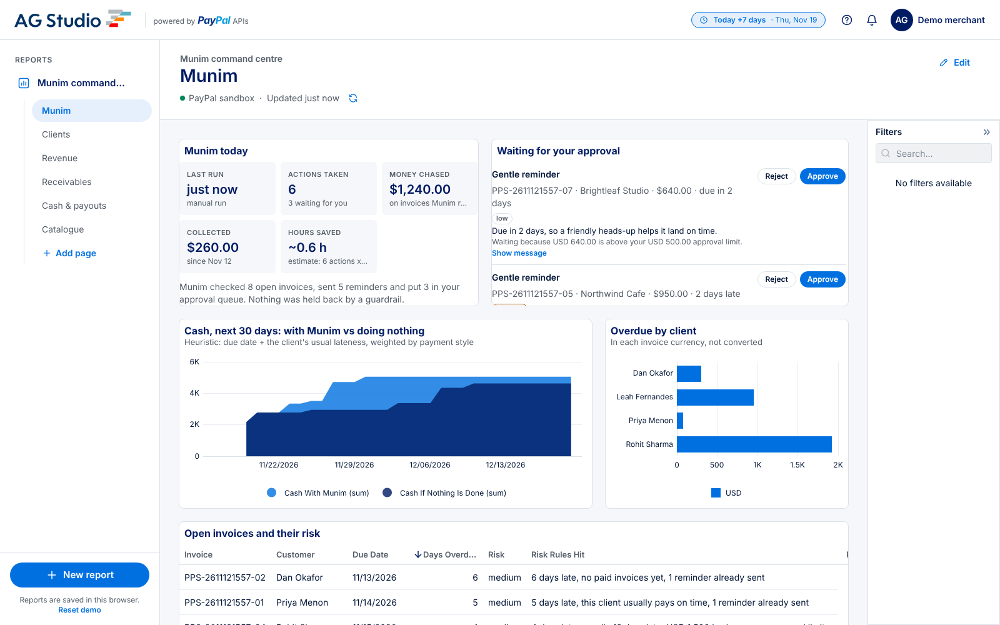
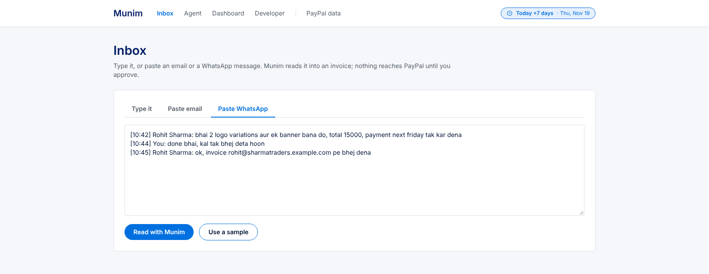
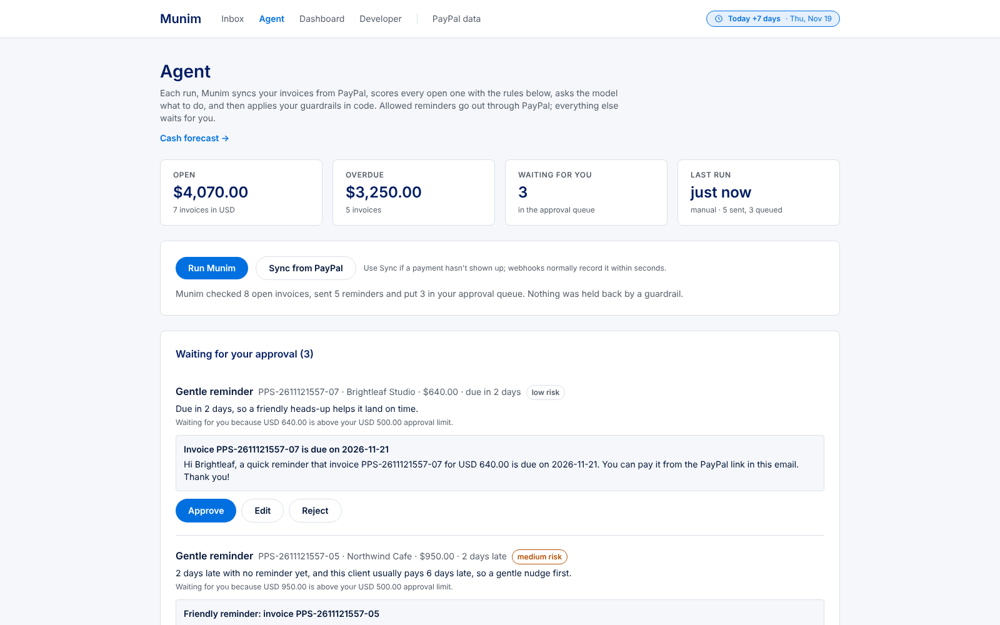
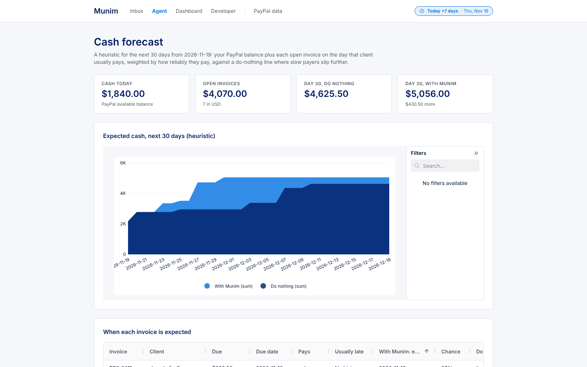
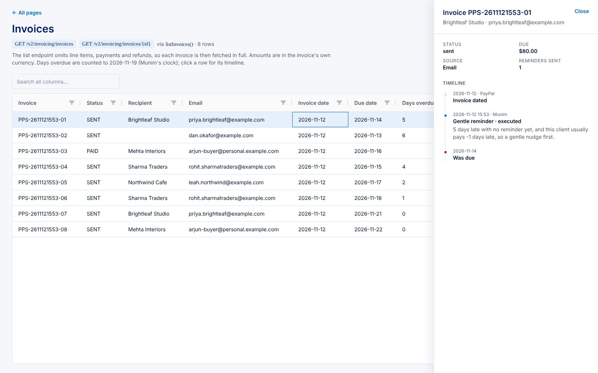
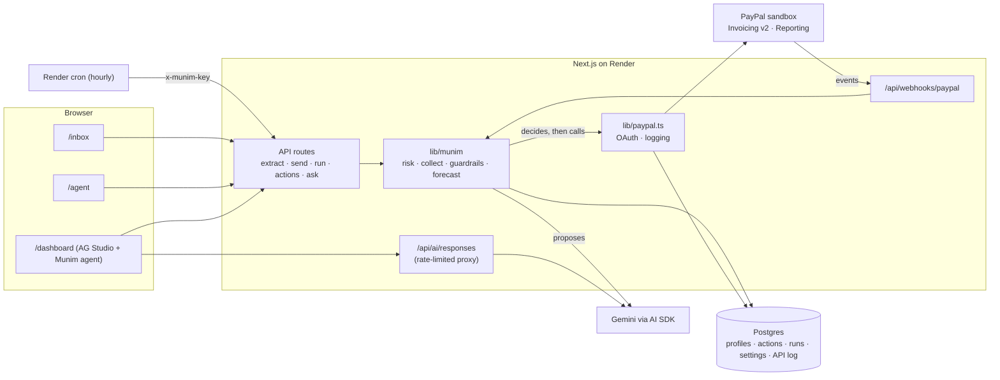

# Munim

Munim is the finance employee a small business can't afford to hire: it turns a message into a PayPal invoice, chases the client politely, and tells you when the money will land.

**Live demo:** https://munim.onrender.com (replace with your Render URL) · **Video:** https://youtu.be/REPLACE_ME · [](LICENSE)

Built for the [PayPal AI Hackathon](https://paypalaihackathon.devpost.com). Everything runs in the PayPal sandbox.



## The problem

A freelancer or a five-person studio spends hours every month typing up invoices from WhatsApp chats and emails, then working up the nerve to remind people who haven't paid. Most of them never send the third reminder, so late invoices quietly become write-offs. They also have no idea whether the rent money will be there on the 30th, because they don't know which clients pay on time.

## What it does

### Invoice

Paste an email thread or a WhatsApp chat (Hindi and Hinglish are fine) or just type "bill Dan $1,200 for October maintenance". Munim pulls out the client, line items, currency and due date, matches the client to someone it already knows, and shows you an editable preview. When you press **Approve & send via PayPal**, it creates the invoice, sends it, and keeps the original message next to it.



### Collect

Every hour, or when you press **Run Munim**, Munim checks each open invoice. It scores how risky each one is, from how late it is, the amount and how that client has paid before. It then decides what to do: nothing, a gentle reminder, a firm reminder, offering a part-payment, or flagging it to you. Code rules have the final say. There is a cap on reminders per invoice, a minimum gap between reminders, quiet weekends, PayPal's two-reminders-a-day limit, and approval for anything above a threshold. Anything that needs you waits in a queue with its reason, and you can approve, edit or reject it.



### Forecast

Munim learns each client's habits from what they've actually paid (prompt, slow, pays in parts, or unknown). It projects your balance day by day, alongside a second line showing what happens if nobody chases. The difference between the two lines is what the reminders are worth.



### Ask

The dashboard is an AG Studio report with Munim as its AI agent. Ask "Who owes me the most?" or "Will I have $3,000 by the 30th?" and it answers from live PayPal data. "Chase everyone more than a week late" puts reminders in the approval queue; it never sends them straight away. If you ask for a chart, Munim hands the job to Studio's own chart agents.



## How PayPal is used

| PayPal tool | What Munim does with it | File |
| --- | --- | --- |
| OAuth 2.0 client credentials | Gets and caches the access token for every call. Each call, including the token call, is written to the API log with its status, time and `debug_id`. | `lib/paypal.ts` |
| Invoicing v2: next invoice number, create draft, send | Turns an approved preview into a real invoice. Idempotency keys stop a double click from creating two invoices. | `lib/paypal.ts`, `app/api/munim/invoices/send/route.ts` |
| Invoicing v2: remind | Sends the gentle and firm reminders Munim writes, within PayPal's two-a-day limit. | `lib/paypal.ts`, `lib/munim/collect.ts` |
| Invoicing v2: get, list | Reads every invoice and its payments to build client profiles, risk scores and the forecast. | `lib/munim/receivables.ts`, `lib/munim/payments.ts` |
| Invoicing v2: update (full PUT), cancel | Offers a part-payment by turning on `partial_payment`. If PayPal won't update a sent invoice, Munim creates a replacement, cancels the original, then sends the replacement. | `lib/paypal.ts`, `lib/munim/collect.ts` |
| Invoicing v2: record payment | There is a wrapper, but the demo doesn't use it: Munim reads the payments PayPal records itself. | `lib/paypal.ts` |
| Webhooks + signature verification | `INVOICING.INVOICE.PAID` and similar events update the invoice timeline and client profile within seconds. Events that fail `verify-webhook-signature` are logged and change nothing. | `app/api/webhooks/paypal/route.ts`, `lib/munim/webhook.ts` |
| Reporting: balances | The forecast's starting balance. | `lib/munim/forecast.ts`, `lib/dashboard-data.ts` |
| Reporting: transactions | Shown on the dashboard's revenue pages and the `/transactions` page from the boilerplate. | `lib/dashboard-data.ts` |
| Sandbox business + personal accounts | The business account sends the invoices. `npm run seed` sends one invoice to the personal account so you can pay it and watch the webhook arrive. | `scripts/seed.ts` |
| PayPal AI Toolkit (skills + sandbox MCP server) | Not called by the app. It wasn't available in the cloud session where most of Munim was built, so the endpoints were checked against PayPal's Invoicing v2 reference instead (see `NOTES_SPONSORS.md`). | |

Everything runs against `api-m.sandbox.paypal.com`. There is no live mode.

## How AI is used

| AI tool | Job |
| --- | --- |
| Google Gemini (`GEMINI_MODEL`, `gemini-flash-latest` by default, free tier) via the Vercel AI SDK | Reads emails, chats and typed notes into an invoice using structured output checked against a zod schema. |
| Same model, same SDK | Decides one action per open invoice and writes the reminder text and a one-sentence reason. |
| Same model, same SDK | Writes the plain-English summary at the end of each run. |
| Munim as a custom agent in the AG Studio Agent Framework (optional: needs an OpenAI key in `AG_STUDIO_OPENAI_API_KEY`, hidden without one) | Answers questions on the dashboard with its own tools (open invoices, client profile, forecast, approval queue, activity, propose reminder, run collections, approve action). It delegates charts and layout to Studio's built-in lead, page, widget, data and planning agents. |

The model proposes and code decides. Every decision the model makes goes through guardrails in `lib/munim/collect.ts`, which can hold it for approval, downgrade it or skip it. Each outcome is saved as an `AgentAction` with a one-sentence reason and the name of any guardrail that changed it, so you can always see why Munim did something. If there is no Gemini key, the same pipeline runs on simple rules, so the demo still works.

## Sponsor tools

**AG Grid / AG Studio.**
- AG Grid Community runs the editable line-item grid in the Inbox, the activity log on `/agent` (with custom badge renderers and quick filter), and the `/invoices` grid, which gained a row-click timeline panel.
- AG Studio runs `/dashboard`, the "Munim command centre". It has Munim and Clients pages first, then the boilerplate's revenue and receivables pages.
- Two custom widgets built with `createWidgets`: "Munim today" and a live "Approval queue" you can act on.
- The forecast chart and Munim's tables are added as Studio data sources.
- The theme matches the app's buttons and inputs.
- Munim is registered as the primary custom agent through `createAiHarness`.

**APIMatic Context Plugin.** I planned to use it to check PayPal's request shapes while writing `lib/paypal.ts`. It wasn't available in the cloud session where most of the code was written, so I checked the same things against PayPal's published reference. The most useful catch was that `allow_partial_payment` lives under `configuration.partial_payment`, not directly under `configuration`. I also confirmed that `invoicer.email_address` has to match the business account, and that a full PUT will email the client unless you turn that off. The dated log is in `NOTES_SPONSORS.md`.

**Render.** `render.yaml` is a Blueprint for three things:
- a Node web service that runs migrations during the build and has a health check on `/api/health`;
- a Postgres database;
- an hourly cron job that calls `POST /api/munim/run` with a shared key, so Munim chases invoices on its own while you sleep.

## Other tech

Next.js 16 (App Router), React 19, TypeScript, Tailwind 4, Prisma 7 with the `pg` adapter, Postgres, and zod.

Built on PayPal's [hackathon AG Grid boilerplate](https://github.com/paypaldev/hackathon-paypal-ag-grid-boilerplate). Its PayPal client, data grid, endpoint pages and AG Studio dashboard are the starting point, and its pages for products, plans, balances and transactions are still there under "PayPal data". AG Grid Community is MIT-licensed. AG Studio is a commercial product with its own licence: without an `AG_STUDIO` key it runs in trial mode and shows a banner.

## Run it locally

You need Node 22, a Postgres database and a PayPal developer account.

**1. PayPal sandbox setup**

1. Sign in at [developer.paypal.com](https://developer.paypal.com) and open **Apps & Credentials** with the **Sandbox** toggle on.
2. Click **Create App** and choose type **Merchant**. Copy the **Client ID** and **Secret**.
3. In the app's settings, under features, tick **Invoicing** and **Transaction search**, then save. Transaction search can take a few hours to start returning data.
4. Go to **Testing Tools > Sandbox Accounts**. Copy the email of the **Business** account (it owns the app) and of the **Personal** account (you'll pay an invoice with it). Use **View/Edit account** to see the personal account's password.

**2. Install and configure**

```bash
git clone https://github.com/<you>/munim.git
cd munim
npm install
cp .env.example .env.local
```

Fill in `.env.local`:
- `PAYPAL_CLIENT_ID`, `PAYPAL_SECRET`
- `MERCHANT_EMAIL` (the business email) and `SANDBOX_PAYER_EMAIL` (the personal email)
- `DATABASE_URL`
- `GEMINI_API_KEY` (free at https://aistudio.google.com/apikey)

Every variable has a one-line comment in `.env.example`.

**3. Database, seed data and dev server**

```bash
npx prisma migrate dev     # creates the tables
npm run seed               # Pixel & Pine Studio: 5 clients, 8 sent sandbox invoices
npm run dev                # http://localhost:3000
```

You can run the seed again: it cancels its earlier invoices before creating new ones. It prints a payer link for the invoice sent to your personal account.

**4. Webhooks (once deployed)**

PayPal can't reach localhost, so this step comes after you deploy.
1. Deploy with the Blueprint (Render > **New > Blueprint**, pick the repo, fill in the values marked as secrets, and set `APP_URL` on the cron job to the web service URL).
2. In the sandbox app, click **Add Webhook** and enter `https://<your-app>/api/webhooks/paypal`. Tick the Invoicing events (or all events).
3. Put the webhook id PayPal shows into `PAYPAL_WEBHOOK_ID` and redeploy.

Without webhooks, the **Sync from PayPal** button on `/agent` does the same job by hand.

### Try this

1. Open `/inbox`, choose **Paste WhatsApp**, click **Use a sample**, then **Read with Munim**.
2. Check the preview and click **Approve & send via PayPal**. The invoice is now in the sandbox business account.
3. Click the clock pill in the header and choose **+7 days**, so several invoices become overdue.
4. Open `/agent` and click **Run Munim**. Watch each decision stream in, with its reason and any guardrail that changed it.
5. In **Waiting for your approval**, click **Approve** on one item. The reminder goes out through PayPal and the activity log updates.
6. Open `/dashboard` and click the prompt starter **Will I have $3,000 by the 30th?**

To see a payment come in, open the payer link from `npm run seed`, log in as the sandbox personal account and pay. Then press **Sync from PayPal**, or wait for the webhook.

## Architecture



## Limitations and what's next

**Limitations**

- The rate limit on the AI and extraction routes is in memory, per server instance. It resets on restart and isn't shared if you run more than one instance.
- The forecast is a heuristic based on each client's past lateness, not a trained model. It only totals one currency (`MUNIM_CURRENCY`), and other currencies are listed but not converted.
- There are no user accounts. Munim works for one sandbox business, and anyone with the URL can see the demo data and approve actions.

**What's next**

- Sign-in with PayPal and one Munim per merchant, so it can run for real businesses.
- Send reminders on the channel the invoice came from, such as a WhatsApp message alongside PayPal's email.
- Use the forecast to suggest when to offer a part-payment or an early-payment discount, before the invoice is late.

## License

MIT, see [LICENSE](LICENSE). The boilerplate this is built on comes from PayPal's developer relations team. AG Studio is a separately licensed dependency.
